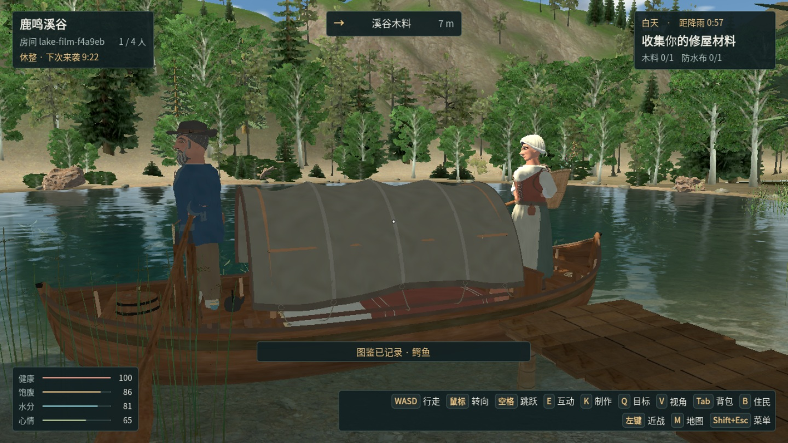

# Cooper

**1–4 人合作生存 · 1–4 player co-op survival**

桌面浏览器和 macOS · Desktop browsers and macOS

第一场雨来前，和队友分头去溪谷取木料、上瞭望塔找防水布，再回木屋修好屋顶。雨停后，可以划船穿过鹿鸣湖、进矿洞找矿，或游到外海小岛看乐山大佛。营地的红色飞船能带你一路升到 100 公里高空。

Split up before the first storm. Gather timber in the creek valley and find a tarp at the lookout, then meet back at the cabin to repair the roof. After the rain, row across the lake, explore the mines, or swim to the offshore island to see the Leshan Giant Buddha. Back at camp, the red spacecraft can take you 100 km above the coast.


| 鹿鸣湖上的队友 · Crewmates on the lake | 从外海小岛望向乐山大佛 · The Buddha from the offshore island |
| --- | --- |
|  |  |

## 局域网开局 · Host on your LAN

房主需要 Node.js 24、Godot 4.7.2、Python 3、NumPy 和 Pillow。在项目根目录运行下面两条命令，同一 Wi-Fi 的队友打开终端显示的邀请地址即可加入。

The host needs Node.js 24, Godot 4.7.2, Python 3, NumPy and Pillow. Run these commands from the project root, then share the printed invite URL with players on the same Wi-Fi.

```sh
npm run coop:build:web
npm run coop:lan
```

[操作与构建 / Controls & builds](docs/play.md) · [MIT](LICENSE) · [素材署名 / Asset credits](THIRD_PARTY_NOTICES.md)
