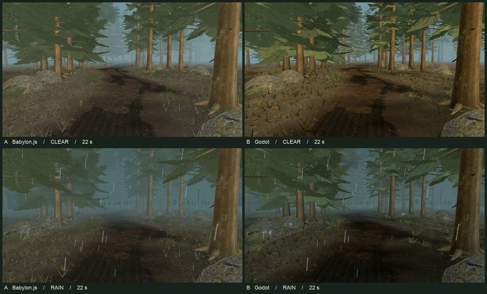

# 雨后林径 · 引擎对比

**建议下一轮玩法原型用 Godot。** 同一个 Chrome 窗口里，两版行走时都接近 60 FPS，雨天 P95 帧耗时只差约 0.2 ms。两边都通过了操作和加载检查，Godot 还已用同一场景导出可运行的 Mac 版。Babylon 的优势在首次进入：冷启动 0.77 秒，Godot 为 3.48 秒，子资源传输量约为后者的三分之一。如果本轮要考核访客从点开链接到开始玩的速度，A 有优势。

## 本机网页结果

2026-11-18，MacBook Pro（Apple M1，16 GB），macOS 26.5.2。Playwright 驱动有窗口的 Google Chrome 157.0.8103.79。两版使用同一进程、窗口和标签页，ANGLE Metal 显示 Apple M1，WebGL 2 绘图缓冲区实测均为 1280 × 720。四次测试串行进行，标签页全程可见。

| 版本 | 浏览器缓存 | 首次可操作 | 晴天平均 FPS | 晴天 P95 帧耗时 | 雨天平均 FPS | 雨天 P95 帧耗时 | 子资源传输 |
|---|---|---:|---:|---:|---:|---:|---:|
| A · Babylon | 冷 | 0.77 s | 59.9 | 17.5 ms | 60.0 | 17.7 ms | 31.72 MiB |
| A · Babylon | 热 | 0.92 s | 59.9 | 17.7 ms | 60.0 | 17.7 ms | 29.84 MiB |
| B · Godot | 冷 | 3.48 s | 59.6 | 18.0 ms | 59.7 | 17.9 ms | 93.04 MiB |
| B · Godot | 热 | 2.36 s | 59.0 | 18.1 ms | 59.7 | 17.9 ms | 92.73 MiB |

每个引擎的冷启动前，清除 Chrome HTTP 缓存及 localhost 站点数据。热启动在同一标签页访问相同 URL。浏览器上下文为非持久化，系统文件缓存与驱动缓存可能已预热。热启动仍有大文件重新传输。传输列为 Resource Timing 同源子资源的 transferSize 合计，含响应头开销。服务支持 ETag，使用本地未压缩 HTTP。一次冷、一次热只能描述此次运行，Safari、移动端、远程下载与长时间游玩待测。

[逐帧记录 A 冷](../evidence/a-cold.json) · [A 热](../evidence/a-warm.json) · [B 冷](../evidence/b-cold.json) · [B 热](../evidence/b-warm.json)

**为什么复用同一窗口。** 最初分别启动 Chrome 时，A 约 25 FPS，B 约 60 FPS。随后在另一个共用窗口的五秒交叉检查中，两版都跟随约 25 Hz 的浏览器动画回调。上表的四轮正式重测使用同一个窗口，同时独立计数 requestAnimationFrame，测得 59.3–60.0 Hz。窗口间回调频率的差异足以改变表面排名，这组数据也无法衡量超过 60 FPS 的性能余量。[交叉检查](../evidence/frame-audit.json) · [首轮原始数据](../evidence/initial)

## 同机位晴雨与操作

树皮、岩面与林地采用同源 PBR 材质。363,226 个三角面由两版共用，树根接触阴影烘在顶点颜色中。两版均为一束方向光、环境补光和深度雾，无实时阴影。材质、滤波与雾在两个渲染器中的响应仍有可见差异。树冠和蕨叶采用透明裁切面片，水迹通过粗糙度和法线表现。单帧画质可打开各自原图比较。[A 晴](../evidence/a-clear.png) · [A 雨](../evidence/a-rain.png) · [B 晴](../evidence/b-clear.png) · [B 雨](../evidence/b-rain.png)

两端均用浏览器实际输入检查了点击锁定、前进、转向、R 往返切换和 Esc 释放。碰撞检查将起点摆到同一块半径 0.956 米的岩石前，持续按 W 1.5 秒，测得石心到相机水平距离分别为 1.286 米与 1.282 米，设定最小安全距离为 1.246 米。地面是平面，活动区域内眼高锁定为 1.67 米。四轮结束时均读回木棚内坐标 (1.9, −89.7)。以 60 Hz 对整条 98.48 米路线做几何采样，扣除玩家半径后最小障碍净距为 0.99 米。自由走完整段的手感仍由试玩者判断。[A 操作记录](../evidence/a-controls.json) · [B 操作记录](../evidence/b-controls.json)

## 同一次天气迭代

同一个 `shared/layout.json` 中，基准参数位于 `weather.base`，加大雨量的实验位于 `weather.storm`。两版都实际加载了实验档并截图，无需手点编辑器。改参数后，分别执行 `npm run build:a` 和 `npm run build:b` 即可同步两套构建。A 的材质/雨丝逻辑在 `web/src/main.ts`，B 在 `godot/main.gd`。本次迭代只改共享参数。

| 雨中参数 | 基准 | 大雨 |
|---|---:|---:|
| 同时绘制的雨丝 | 780 | 1,550 |
| 下落速度 | 15 m/s | 19 m/s |
| 泥面粗糙度系数 | 0.47 | 0.23 |
| 岩面粗糙度系数 | 0.52 | 0.37 |
| 泥石底色压暗 | 13% | 26% |

[A 大雨同机位](../evidence/a-storm.png) · [B 大雨同机位](../evidence/b-storm.png)。原生逻辑检查也读回了 0.23 / 0.37 的实值。[Godot 导入与逻辑记录](../evidence/godot-logic.json)

## Mac 原生参考

已在本机通过 LaunchServices 打开最终的 `dist/native/Woodland.app`，完整运行 60 秒后正常退出。Compatibility 使用 Apple M1 的 OpenGL 4.1 Metal，视口 1280 × 720。引擎时钟至首帧 4.10 秒。晴天 108.7 FPS、P95 14.78 ms，雨天 119.2 FPS、P95 14.73 ms。这里统计 Godot 的 frame_post_draw 间隔，首帧计时起点也与浏览器导航不同。仅作原生参考。[原生记录](../evidence/native.json)

临时启动验证中，直接执行 Check.app 的内部二进制触发两次 macOS AppKit 应用注册 SIGABRT，发生在场景加载前。临时应用已清理，成品采用 LaunchServices 启动。Godot 编辑器仍位于 Downloads。当前工作区拒绝写入 /Applications。试玩和导出均无需移动编辑器。
