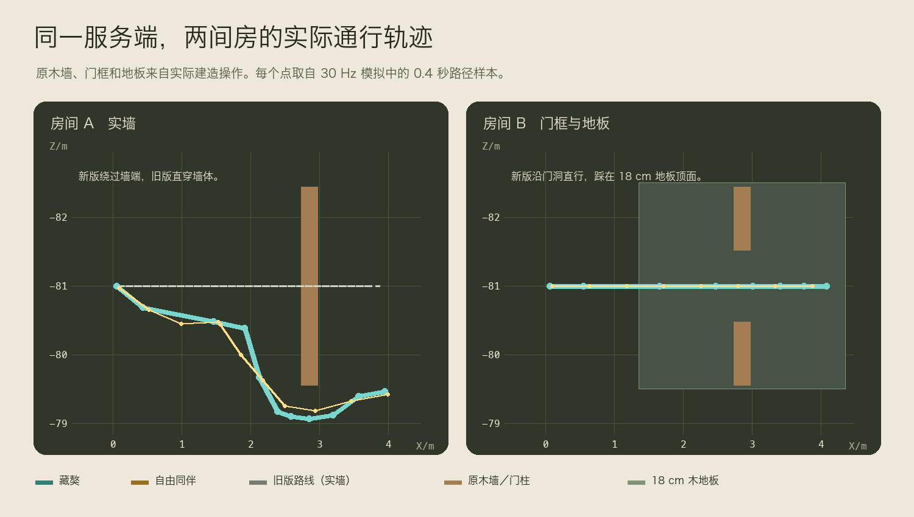

# 藏獒和自由同伴的建造物通行

同一个 Godot 4.7.2 服务端开启两个内存房间，由游戏处理建造、拾起、放置与角色模拟。两房间共用鹿鸣湖营地实地图，起点为 `(0.05, -81.00)`，构件中心为 `(2.85, -81.00)`。每段以 30 Hz 采样角色身体与原构件碰撞盒的重叠情况，图中每隔 0.4 秒记录一个路径点。房间记录在测试内存中，收养和存档回归用独立临时目录。



| 障碍 | 旧版重叠帧（狗 / NPC） | 优化后重叠帧（狗 / NPC） |
| --- | --- | --- |
| 房间 A 的实墙 | 25 / 16 | 0 / 0 |
| 房间 A 的 35 cm 木箱 | 29 / 20 | 0 / 0 |
| 房间 A 的 79 cm 营地木桌 | 37 / 27 | 0 / 0 |
| 房间 B 的门框 | 0 / 0 | 0 / 0 |

两者绕过实墙、木箱和桌子，穿过门洞。抬起房间 A 的墙后，两者从原址直穿。墙放到新位置后，原来的路线仍通行。房间 B 在这些操作期间保持原门框和地板，两房间拥有各自的障碍缓存。

房间 B 的角色根节点在地板上比地面高 `0.180000007 m`。移走地板后的首个服务端快照、客户端 JSON 解码与两个真实 Godot 角色场景均给出 `0 m`。旧狗档缺少 `y` 时保留保存的 X/Z 并采用地面高度。倾斜地板的预期高度 `0.176817864 m`，实测 `0.176818535 m`，误差约 `0.0007 mm`。海岸斜坡在本次探测点保持 `3.547356844 m` 的行走高度，叠到 `0.36 m` 的双层板前会停下。测量对象为角色根节点和身体代理盒。

## 服务端耗时

三个版本在同机、同地图、两房间的独立进程中顺序执行。计时范围是服务端模拟一步，单位为毫秒，包含两房间，移除 socket I/O。逐步原始微秒数在各 JSON 的 `cases.<阶段>.simTime.ticksUs`，轨迹在 `cases.<阶段>.<房间>.<角色>.trace`。首段最慢步包含静态寻路首次构建，三版的一次冷启动样本分别为 `803.630`、`436.423`、`432.230 ms`。

| 阶段 | 样本 | 旧版 P95 | 首个修复候选 P95 | 优化 P95 |
| --- | ---: | ---: | ---: | ---: |
| 实墙与门框 | 420 | 0.767 | 9.086 | 2.654 |
| 抬起墙 | 270 | 0.696 | 7.833 | 1.790 |
| 放到新位置 | 270 | 0.725 | 8.545 | 1.899 |
| 木箱 | 360 | 0.763 | 8.503 | 2.027 |
| 营地木桌 | 360 | 0.711 | 9.322 | 2.194 |

[旧版原始记录](baseline.json) · [首个修复候选记录](first-candidate.json) · [优化记录](optimized.json) · [工作区高度传输与场景记录](workspace-transport.json)

## 复测

在已导入资源的工作区运行回归。`--visual` 让实际服务端发布 JSON，经网页和原生共用的 `network.gd` 解码后驱动两个客户端视图。`--baseline` 用于在修复前的源代码上复现本报告中的故障。

```sh
Godot --headless --path coop --script ../scripts/test-coop-room-navigation-fit.gd -- --visual
```

工作区通过 34 项房间与视图检查、6 条 NPC 原有地图路线、68 项 NPC 生命周期检查、4 个真实模型的 28 项步态和转身检查，以及两套模型的取水采果检查。采用真实营地场景的反馈测试与生存测试也通过，覆盖藏獒收养、跟随、等待、休息和重启恢复。反馈测试退出时，Godot 报告有 9 个 ObjectDB 实例尚未清理。另有 macOS 无头环境读取系统证书的日志，以上测试均返回成功。

[导航](npc-navigation.json) · [生命周期](npc-lifecycle.json) · [动画](npc-motion.json) · [交互动作](npc-work.json) · [场景模型](npc-scene.json) · [游戏反馈](feedback.txt) · [生存与重启](survival.txt)

| 工作区文件 | SHA256 |
| --- | --- |
| `coop/companion_footing.gd` | `0b2e5f029651458c72a69befa0767a766902c8b7ab412906d5e502cdbba221f5` |
| `scripts/test-coop-room-navigation-fit.gd` | `3d9a6f1c1a1db4f37f078cdf7ff80d602230833db7dd6c14cfc90b6a9499fcad` |
| `coop/world.json` | `5c808c9fe22149c26d8b574e4a43ae3330fc771aafa1e319a1f12ea02712631a` |
